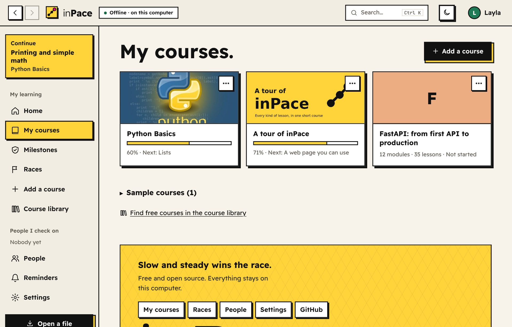
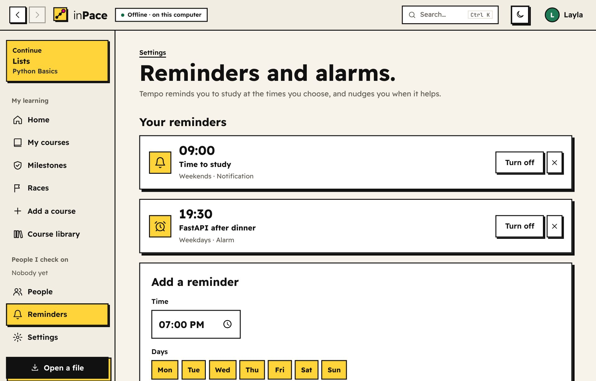
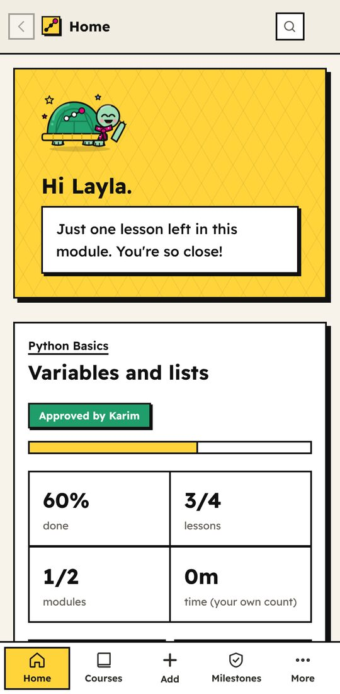
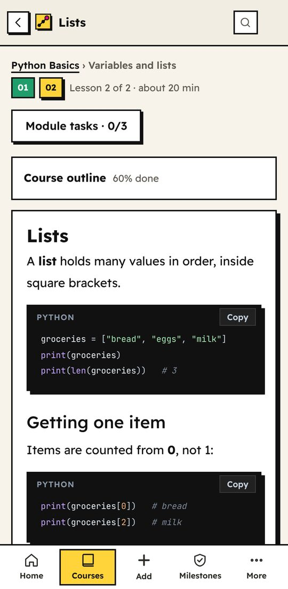
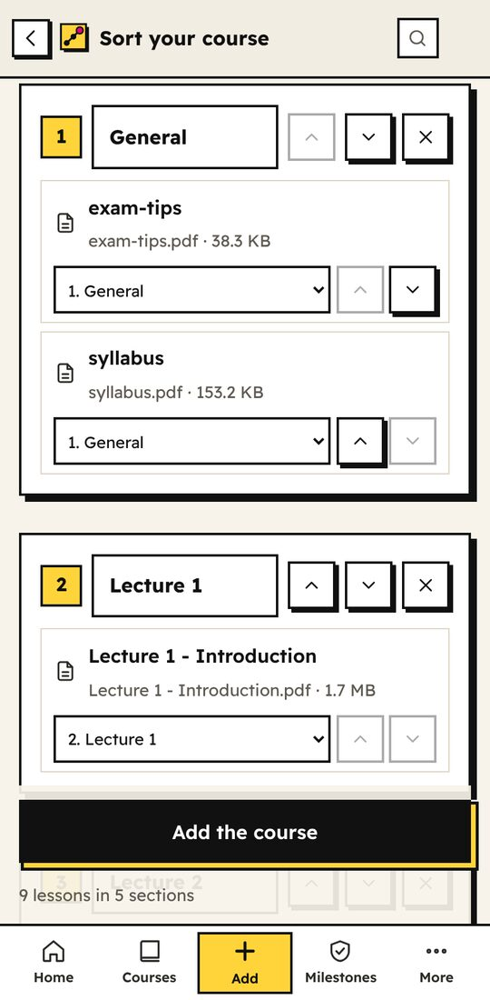
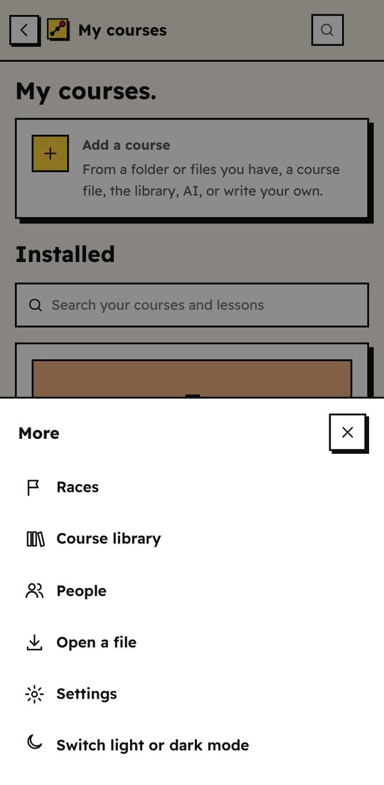

<p align="center"></p>

<h1 align="center">inPace</h1>
<p align="center"><b>Learn at your pace. Prove you kept it.</b><br>
A free, open-source app that helps you follow a course and lets someone you trust check that you're really keeping up. For Windows, Mac, Linux and Android. Everything stays on your device.</p>
<p align="center"><a href="https://mahmoudyosrimahmoud13.github.io/inPace/"><b>Website</b></a> · <a href="https://mahmoudyosrimahmoud13.github.io/inPace/guide.html"><b>Guide</b></a> · <a href="https://github.com/mahmoudyosrimahmoud13/inpace/releases/latest"><b>Download</b></a> · <a href="https://mahmoudyosrimahmoud13.github.io/inpace-library/"><b>Course library</b></a></p>

<p align="center"></p>

---

## What it does

**Learn**
- **Follow a course step by step.** Lessons, then tasks: upload your work, explain it in your own words, take a quiz. The next module unlocks when you finish.
- **Add a course the easy way:** press **Add**, then paste YouTube or Udemy links (a long video is cut into lessons at its chapters), build it on one page with drag and drop, or pick a folder of class material, some files, a course file, the course library or AI. No YAML or Markdown needed (it's there if you want it).
- **Folders:** sort My courses into folders like "Programming languages" or "Networks".
- **Messy folders are fine:** inPace sorts your files by the week, lecture or chapter numbers in their names (or by kind: videos, slides, notes). You fix anything by dragging files between sections, or ask AI to sort them. Then choose: leave the files where they are (no extra space, even for a 60 GB course) or copy them into inPace.
- **Turn a book into a course.** Give inPace a PDF book: each chapter becomes a part of the course and each section a lesson that opens only its own pages (`book.pdf#pages=12-19`). Your place is saved in each part.
- **Videos, audio, PDFs, Word, PowerPoint, Excel, code and web pages.** The video player remembers the second you stopped at. PDFs open in a built-in reader that remembers your page. Word, PowerPoint and Excel files show as a light, read-only preview right in the lesson, with a button to open them in their own app. Code shows in colour with a Copy button. Web pages run in a locked box. YouTube and Vimeo load only when you press play.
- **AI courses around your own material.** Attach a book or some files when you make a course with AI. They become part of the course, and the prompt tells the AI the book's chapters and pages so each lesson opens the right part.
- **Tempo's island, a reward with a story (optional).** Every focus trip grows a plant on Tempo's shell (14 kinds), and lessons, reviews, milestones and races bring 8 animal friends to live there. Ten chapters of adventure open as the island grows, and your real pace is the weather: stop for days and the Fog of Someday comes for the island, and after 10 days your plants start to wilt (a gentle mode is there for hard weeks). Shells you earn by learning (courses hide treasure chests along the way) decorate the island, which has your name for it, and the sky follows your real clock. Friends you add see your island, and you can share a picture of it.
- **Your own turtle.** Make a turtle (shell, scarf, skin, something to wear) instead of picking a colour. It's your picture everywhere, travels on your contact card, and you can save it as a picture to share. Tempo shows up in your notifications too.
- **Fair quizzes.** Each question has several right and wrong answers. Every quiz shows one right answer mixed with wrong ones, in a new order each time.
- **Daily review.** Old questions come back over days and weeks so they stick.

**Share and find courses**
- **[Course library](https://mahmoudyosrimahmoud13.github.io/inpace-library/).** Browse free courses other learners made, look inside each one (every module, lesson and task, plus a lesson to read), and add it with a click, right inside the app.
- **Publish your own** with **More → Publish to the library**. It's signed with your inPace key, so only you can update it.
- **Send a course as a short link.** A course from the library goes as a link, not a file, and your friend always gets the newest version.
- **Courses with big videos** can point to a download link (Google Drive, MEGA, archive.org…). Learners download the videos, choose the folder, and every lesson finds its video.

**Find your way**
- **Search anything** with **Ctrl+K** (or `/`): lessons, courses, tasks, people and pages. My courses also has its own search box.
- **Course pictures** make your courses easy to tell apart. Add one in the builder, or put a `cover.jpg` in a course folder.
- **On phones,** a tab bar at the bottom (Home, Courses, Add, Milestones, More) always shows where you are.
- **Back and forward buttons** at the top left (or **Alt+← / Alt+→**, or your mouse's side buttons), since the app window has no browser buttons.
- **Continue** where you left off from the sidebar, see the **course outline** on every lesson, and press **N** / **P** for the next and previous lesson.
- **Keep courses tidy:** update a course when a newer file arrives (your progress is kept), refresh a folder course when you add videos, or delete a course you don't need.

**Stay on track**
- **Milestones.** Each one is signed by you and linked to the one before it, so your history can't be quietly rewritten.
- **A checker you trust.** Send your friend link on Telegram, WhatsApp or email. They tap it, inPace opens and adds you, and one more tap sends theirs back. Then send your progress the same way. Your friend, parent or mentor sees what you did and approves it. They don't need to know the subject.
- **Links instead of files.** Friend invites, progress and replies go as links that open inPace straight on the right screen. Progress links only carry what your checker hasn't seen yet, so they stay small. When something is too big for a link, inPace makes a file instead.
- **Weekly goals and breaks.** Set a pace, see your streak and finish date. Planned breaks don't count against you.
- **Reminders and alarms.** Pick the times and days you study. Each reminder is a notification or an alarm that rings until you stop or snooze it, on your computer and your phone, even when inPace is closed. Tempo also nudges you when it helps: when he misses you after a week away, when your weekly goal is at risk, when questions are due for review, and when a finished module needs a milestone.
- **Races.** Race friends. Only approved milestones count, so it stays fair.

<p align="center"></p>

**Proof that holds up**
- **Verified exams.** Your checker's app makes the exam and keeps the answers. You take it once, offline, and their app grades it.
- **See the real work.** Checkers can ask for any file you added, and inPace confirms it's the original.
- **Learning record.** One web page you can share or link from a résumé. Anyone can click "Verify" to check it.

**Yours**
- **Private by design.** No accounts and no tracking. inPace only goes online for things you turn on, and files only leave your computer when you send them.
- **Make it look your way:** seven color profiles, light and dark mode, English and Arabic (right to left), and a welcome tour with Tempo the turtle that you can replay any time.
- **Updates itself** if you allow it, and **encrypted backups** you can restore on any computer.

## On your phone

<p align="center">




</p>

The **Android app** is the whole of inPace, not a smaller version: the same courses, milestones, races and checkers, with no account and no internet needed.
- **A tab bar at the bottom** (Home, Courses, Add, Milestones, More) that always shows where you are.
- **Add your class material** from files you pick or a folder on your phone, sorted for you.
- **Send progress** to your checker on WhatsApp or Telegram, and inPace links open straight in the app.
- **Move between phone and computer** with a backup.
- **Reminders and alarms** arrive as Android notifications, even when the app is closed.
- **Updating:** download the new APK and tap *Update*. Your courses and progress stay.

## How it works

inPace is a small website that only lives on your computer. When you open it, it starts a tiny server that only your computer can reach, and shows it in its own app window. Everything is saved in one folder (`Documents/inPace`). Your milestones are signed with a key that never leaves that folder, and checking happens by swapping files with people you choose. No server, no account, no cloud. The Android app carries Python inside it and runs the same server on the phone.

**Read the full explanation in [How inPace works](docs/HOW-IT-WORKS.md).** It covers the app window, the data folder, courses and media, sorting your own material, milestones and checking, links, the course library, updates, when inPace goes online, and how the Android app works.

## Download

Go to the [Releases page](https://github.com/mahmoudyosrimahmoud13/inpace/releases/latest) and download the file for your computer:

- **Windows:** `inPace-windows.zip`. Unzip it, then double-click `inPace.exe`.
- **Mac:** `inPace-mac.dmg`. Open it and drag inPace into Applications.
- **Ubuntu / Debian:** `inPace-linux.deb`. Double-click it to install (or run `sudo apt install ./inPace-linux.deb`), then open inPace from your apps.
- **Other Linux:** `inPace-linux.tar.gz`. Unpack it and run `inPace`.
- **Android 7 or newer:** `inPace-android-arm64-v8a.apk`. Open it on your phone and tap *Install*. If your phone asks, allow installing apps from your browser or Files app.

inPace opens in its own window. Everything stays on your device.

(Using the plain Linux `.tar.gz`? For the app window, install `python3-gi` and `gir1.2-webkit2-4.1` once: `sudo apt install python3-gi gir1.2-webkit2-4.1`. Without them, inPace opens in Chrome or Edge as an app window, or in a browser tab.)

> The apps aren't signed yet. **Windows** may show "Windows protected your PC": click *More info*, then *Run anyway*.
> **Mac** may say it can't be opened: right-click inPace, choose *Open*, then *Open* again.

**With Python instead** (3.10 or newer): `pip install git+https://github.com/mahmoudyosrimahmoud13/inpace.git`, then run `inpace`.

**Try both sides on one computer:** run a second copy with its own data folder, `inpace --home ~/inpace-checker`, so you can play learner and checker.

## How the checking works

1. You and your checker connect: in **People**, send your **friend link** on Telegram, WhatsApp or email. They tap it, add you, and tap once to send theirs back. (Pasting the link, or swapping contact-card files, works too.)
2. You learn, then **save a milestone** and **send your progress link** (or download the progress file).
3. You send it to your checker any way you like: WhatsApp, email, USB.
4. Your checker opens it. inPace tells them if anything was changed since they last checked.
5. They approve (or ask a question, or flag a problem) and send back a small reply file.
6. You open the reply. Done.

## What it proves, and what it doesn't

We want to be honest about this.

- **It proves:** the steps of the course were followed in order, the work you added exists, and your history wasn't changed after your checker saw it.
- **It doesn't prove:** that every minute was real study, or that you truly learned. No app can.
- **Quizzes:** practice quizzes are for learning. Public courses come with their answers, so a determined person could look them up. **Verified exams** are stronger, and a checker's **private questions** can't be looked up at all. The strongest proof is still your own work and explanations, which your checker reads.

## Changing checkers or computers

- **New checker:** just add them. They see your full history the first time they open your progress file.
- **New computer:** make a backup (Settings → Backups), then restore it on the new computer. Your key and history move with it.
- **Lost everything without a backup:** start again with a new setup. Your old checker can still see what they approved before.

## Courses

A course is a `.lpack` file (a zip) with:

```text
course.yaml      the modules, lessons and tasks
lessons/*.md     lesson text (Markdown)
questions.yaml   the questions and all possible answers
answers.yaml     which answers are right (left out when sharing with learners)
```

A course can also point to files that stay where they are on your computer (a folder of videos, PDFs or code), so big courses are never copied. See [SPEC.md](SPEC.md) for the full format. Sample courses are built in: **A tour of inPace**, a short course with one of every kind of lesson (video, audio, pictures, code, an interactive page, part of a book, slides, a Word file, a spreadsheet, tasks and a quiz), *Python Basics* in English and Arabic, and **FastAPI: from first API to production**, a 12-module course that goes from your first endpoint to databases, logins, async, testing, WebSockets, Docker and monitoring, and ends with a portfolio project. More free courses are in the **[course library](https://mahmoudyosrimahmoud13.github.io/inpace-library/)**, and you can share yours there too.

## For developers

```bash
git clone git@github.com:mahmoudyosrimahmoud13/inpace.git
cd inpace
pip install -e ".[test]"
pytest
```

Built with Python, Starlette, Jinja, SQLite and PyNaCl (Ed25519 signatures). No JavaScript framework, no build step. Tests run on Windows, macOS and Linux on every push. [How inPace works](docs/HOW-IT-WORKS.md#14-for-developers-where-the-code-is) has a map of the code.

**Making a release:** push a version tag (`git tag v1.10.0` then `git push --tags`). GitHub tests everything, builds the Windows, Mac and Linux apps, checks that each one starts, and attaches them to a new release with a `SHA256SUMS` file that the updater checks. A second workflow builds the Android APK (signed with the release key from the repository secrets) and adds it to the same release. The website in `site/` deploys on every push.

**The Android app** is in [`mobile/`](mobile/README.md): a Flutter shell that runs inPace's Python server on the phone. Build it from GitHub (**Actions → android → Run workflow**) or locally with `bash mobile/build_android.sh` (needs Flutter, Java 21 and the Android SDK).

**Translations:** interface text lives in `inpace/locales/`. Add a language by copying `ar.json`.

## License

MIT. Free to use, change and share.

The pictures of the sample courses were added by the project owner.

Reading book bookmarks uses [pypdf](https://github.com/py-pdf/pypdf) (BSD). The PDF reader uses Mozilla's [pdf.js](https://mozilla.github.io/pdf.js/) (Apache 2.0), included in `inpace/static/pdfjs/` with its license.
