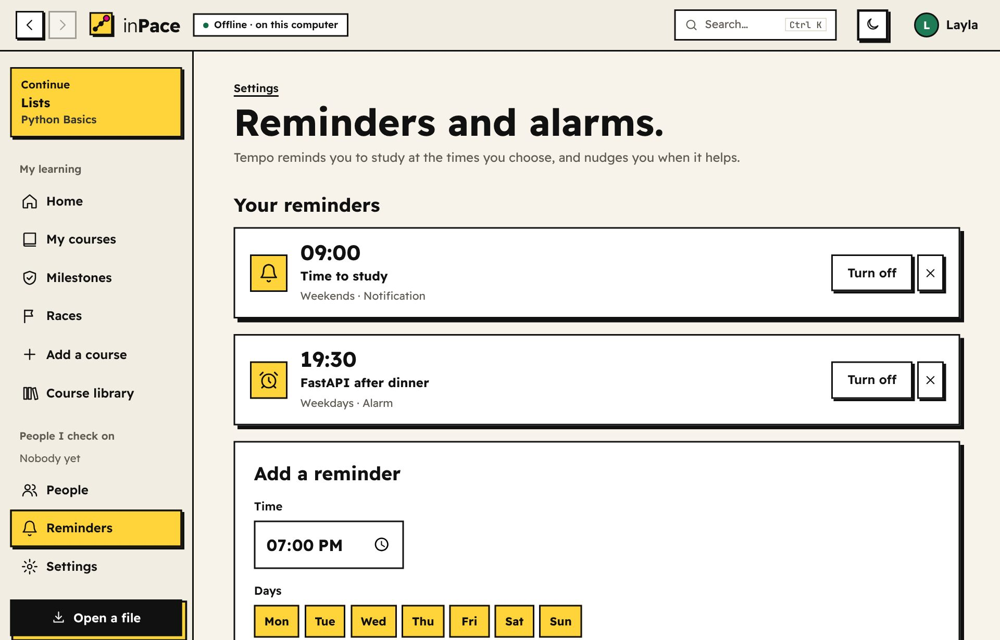

# How inPace works

inPace runs on your own computer or Android phone with no server, no account and no cloud. This page explains what happens when you use it, in plain words.

- **Using the app?** The [guide](https://mahmoudyosrimahmoud13.github.io/inPace/guide.html) shows every feature step by step.
- **Want the exact file formats?** See [SPEC.md](../SPEC.md).

---

## The short version

- **inPace is a small website that only lives on your computer.** When you open it, it starts a tiny web server that only your own computer can reach (`127.0.0.1`). It shows that server's pages in its own app window.
- **The Android app is the same inPace.** It carries Python inside it and runs the very same server on the phone. A full-screen Flutter window shows its pages. See [section 13](#13-on-android).
- **Everything is saved in one folder** on your computer, called your data folder.
- **Your progress is signed.** Each milestone is signed with a key that only your computer has, and it's linked to the milestone before it. If anyone changes the history later, the signatures stop matching.
- **People check each other by swapping links or files.** You send your progress as a link (or a file). Your checker's inPace checks the signatures, and they send back a small approval the same way. Nothing goes through us.

---

## 1. Opening the app

When you double-click inPace:

1. **It closes any copy that's already running** with the same data folder, even an older version. So you never end up with two copies, or an old copy left running after an update.
2. **It starts the local server** on a local port. The port is saved in `running.json` in your data folder.
3. **It opens the app window.** It tries these in order and uses the first one that works:
   - **Windows and Mac:** the system's own web view (through pywebview).
   - **Linux:** a GTK + WebKit window. It draws with the CPU, so it doesn't turn black or spin up the fans on graphics drivers that don't cooperate.
   - **Anywhere:** Chrome or Edge in "app mode", which is a window with no tabs or address bar.
   - **Last resort:** a normal browser tab.

   To force one, set `INPACE_WINDOW`. To see which one would be picked, run `inpace --which-window`.
4. **It checks for updates once a day,** but only if you said yes the first time. Details are in [section 11](#11-updates).

---

## 2. Your data folder

By default this is `Documents/inPace`. You can pick another with `inpace --home <folder>` or the `INPACE_HOME` setting.

```text
inPace/
  identity.key      your private signing key (never leaves this folder unless you make a backup)
  vault.db          your history: events, milestones, people, settings (SQLite)
  courses/<id>/     each installed course: course.yaml, lessons, questions, answers
  media/<id>/       small files that came inside a course pack or that you added in the editor
  evidence/         every file you uploaded as proof, named by its fingerprint (SHA-256)
  course_history/   older versions of courses you edited, for Undo (the last 30)
  pending/<id>/     a newer copy of a course, waiting for you to choose what to do with it
  outbox/           progress files, cards and replies you made, ready to send
  received_files/   files a learner sent you when you asked to see their work
  updates/          downloaded app updates
  tools/yt-dlp.zip  the video downloader for offline YouTube lessons, once you use it
  running.json      which port the running copy uses
```

- **History is append-only.** inPace never edits or deletes past events in `vault.db`. It only adds new ones. That's what makes the history trustworthy.
- **Backups** (Settings → Backups) put this whole folder into one password-protected file that you can restore on any computer. They leave out `tools/`, downloaded YouTube videos and any file over 50 MB, so they stay small.

---

## 3. Courses

A course is plain text: a `course.yaml` file with modules, lessons and tasks, plus lesson text in Markdown.

**Optional tasks** (v1.21). A task with `optional: true` doesn't hold its module back: the module is done when every lesson is read and every other task is done (`Vault.progress`). Optional tasks are listed after the required ones, are left out of the progress percentage and the "x of y tasks" counts, and can still be done. The editor has an **Optional** tick box on each task.

**Optional lessons** (v1.25). A lesson with `optional: true` is an extra: further reading, a long video, a bonus exercise. The module is done without it, and it's left out of the lessons count and the percentage (`Vault.progress` counts only the lessons in `need`). Reading it still saves `lesson_done`, so it shows as done. **Continue** (`next` in `Vault.progress`, `lesson_ahead` in `vault.py`) offers it once, in its place; once you've opened it (a `lesson_opened` event) without marking it done, Continue moves on to the next required lesson. On the lesson page an **Optional** label and **Skip it** sit at the top, before the text. The trail draws it as a dashed stone, the module page lists optional lessons apart, and every editor (the lesson editor, **Add a lesson**, the drag-and-drop builder and the YAML editor) has an **Optional lesson** tick box or key. A module needs at least one lesson that isn't optional. The AI prompt (`ai.py`) tells the AI to put only extras in optional lessons.

**Notes on lessons** (v1.25). A `notes` table in `vault.db` (id, course, lesson, journey, quote, text, dates), never in events, so notes never reach a milestone, a progress file or a shared course; they're in backups because the whole database is. In a lesson, selecting text inside `.prose` shows a **Take a note** button (`app.js`, above the selection with a mouse, under it on touch screens where the phone's own menu sits above). It posts the selected sentence (whitespace collapsed, up to 2,000 characters) and the note to `/learn/<journey>/lesson/<lesson>/notes` with `X-Inpace-Fetch: 1`, and the server sends back the rendered note (`_note.html`), which is added to **Your notes** at the end of the lesson without leaving the page. Saved sentences are found again in the lesson by matching them with spaces ignored, and painted with the CSS Custom Highlight API (no change to the lesson's HTML; browsers without it just skip the highlight). `/learn/<journey>/notes` lists every note in the course's order, `/learn/<journey>/notes.md` downloads them as Markdown, and `POST /notes/<id>` edits or deletes one.

**Ways a course gets in** (all from the **Add a course** page):
- **A course file** someone shared (`.lpack`, `.zip` or `.yaml`).
- **A folder** of course material (videos, slides as PDF, notes, code). inPace makes a first guess, then shows the **organizer**:
  - A neat folder: each sub-folder is a section.
  - A messy folder: files are grouped by the week, lecture or chapter numbers in their names ("Lecture 3", "lec3", "W03", "محاضرة 3"). Files without a number go to "General" at the top. With no numbers at all, files are grouped by kind (videos, slides and PDFs, notes).
  - In the organizer you rename sections and lessons, drag files between sections (or use **Move to** and the arrows on a phone), add or remove sections, and leave files out.
  - **Ask AI to sort it:** the AI sees only the file names. With an AI key in Settings inPace asks it directly; without one you copy the request into any AI chat and paste the answer back. Files the AI forgets go to "Not sorted yet", and file names it makes up are ignored.
  - **Where the files live:** leave them where they are (the default: no extra space, and inPace only remembers where the folder is), or copy them into inPace (`media/<id>/`). Copying shows the size and the free space first, runs in the background, and the course works from the original folder until it finishes.
  - Word, PowerPoint and Excel files (`.docx`, `.pptx`, `.xlsx`) come in as lessons and are grouped as "Documents and sheets". Only old formats (`.doc`, `.ppt`, `.xls`, OpenDocument) can't be shown, so the organizer lists them and suggests saving them as the new formats or as PDF.
- **A book (PDF).** inPace reads the book's bookmarks with [pypdf](https://pypdf.readthedocs.io/) (`organize.book_plan`):
  - Each top-level chapter is a section. Each sub-section is a lesson that points to its own pages, like `book.pdf#pages=12-19`.
  - Pages between a chapter's start and its first sub-section become an "Introduction" lesson. A chapter longer than 30 pages with no sub-sections is split into 12-page lessons.
  - The pages before chapter 1 (cover, contents) start in "Left out".
  - A book with no bookmarks is split every 12 pages, in sections of 60 pages, and you rename them.
  - The same organizer opens, so you can fix anything. The course remembers which file is the book (`book:` in `course.yaml`).
  - A password-protected or damaged PDF gets a plain message instead of an error.
- **Some files you pick.** They're copied into inPace (`drafts/` first, then `media/<id>/`) and sorted in the same organizer. Handy on a phone.
- **A list of links,** one per line. A line starting with `#` starts a new module.
- **With AI.** inPace writes a prompt for a topic, a book, a playlist, a course you're taking, a project, your notes or an exam. You paste it into any AI chat and paste the answer back.
  - **Attach your book or files** (optional). They're copied into `drafts/` (or left where they are, if you give a folder path) and become part of the course when you save it.
  - The prompt then lists each file by name and kind. For a PDF with bookmarks it lists the chapters with their page numbers (up to 3 books), and tells the AI to point lessons at `"<file>#pages=A-B"`. So the AI builds lessons that open the right pages instead of making up text.
- **By hand,** in the course builder.

**Course pictures.** `image:` in `course.yaml` points to a picture next to the course. A picture added in the builder is saved as `media/<id>/cover.*`. A folder course uses a `cover`, `folder`, `poster`, `thumbnail` or `course` picture at the top of the folder. The picture goes inside the course file when you share it.

**Finding the files.** For each lesson file, inPace looks in this order:
1. The exact path, if the course gives a full path.
2. The course's own small files in `media/<id>/`.
3. The folder you pointed it to.

If a folder was moved or renamed, inPace also tries shorter and shorter endings of the path, so it usually still finds the files. If it can't, it asks you where the folder is now.

**Updating a course:**
- **A newer copy arrives.** When you open a course file you already have, but with different content, inPace keeps the new copy aside in `pending/`. It shows you what was added and what was removed, and you choose:
  - **Update my course:** your progress is kept, matched by lesson.
  - **Add it as a separate course:** you get two courses.
  - **Keep mine as it is.**

  If you change your mind, the old version is saved, so **Undo** in the builder brings it back.
- **Folder courses:** **Refresh from its folder** looks in the folder again. New videos become new lessons. Your edits, tasks and progress stay as they are.

**Deleting a course:**
- inPace removes the course and its own small files.
- Your signed milestones for that course are hidden, not erased, because your checker may already have them.
- Adding the course again later starts fresh.
- Your own video folders are never touched.

---

## 4. Lessons and media

Every file is served by the local server under `/m/<course>/<path>`. That keeps working when the course folder is somewhere else on your computer.

| Kind | What you see |
|---|---|
| Video | inPace's own player. It saves your position every few seconds, so you continue from the same second, even after you close the app. |
| Audio | A simple player that also remembers your position. |
| PDF | The built-in PDF reader ([pdf.js](https://mozilla.github.io/pdf.js/), bundled, works offline). It remembers your page. Controls (v1.25): page buttons and a page box; zoom out, a zoom list (fit to width, fit to page, 50% to 400%) and zoom in; rotate; night mode (dark pages); full screen. Ctrl + mouse wheel or a touchpad pinch zooms around the pointer, two fingers pinch on a phone, + − 0 zoom from the keyboard, ← → turn pages, Home and End go to the first and last page. Zooming keeps the spot you were reading in place, and pages keep their old picture until they're drawn sharp again (no blank flash). Each file remembers its zoom and turn (browser storage), and night mode is remembered for every PDF. Only the pages near the screen keep a drawn picture, and a page's picture is never bigger than 16 million pixels, so long books at a big zoom don't run out of memory. |
| Picture | Shown in the lesson; a click (or the button in its corner) opens the picture viewer (`app.js`): fit to the screen, zoom with the buttons, the mouse wheel, + − 0 1, or two fingers, drag to move, double-click or double-tap to zoom in or fit, rotate, ← → for the lesson's other pictures, Escape to close. |
| Part of a PDF | `book.pdf#pages=5-7` opens the same reader limited to pages 5 to 7. Each part remembers its own page. |
| Word, PowerPoint, Excel | A light, read-only preview made inside inPace (`office.py`): headings, lists, tables and pictures; slides in order; each sheet as a table (up to 500 rows and 40 columns). It reads the file's XML with Python's own tools, refuses files that try XML tricks, and caps sizes. A button downloads the file to open in its own app. |
| Code | Coloured code with a Copy button. A project folder shows all its code files. |
| Web page (HTML) | Runs in a locked box (a sandbox), so it can't touch the rest of the app. |
| YouTube, Vimeo | Loads only when you press play, using YouTube's privacy-enhanced mode (youtube-nocookie). Nothing is fetched before you press play. A YouTube video that has a copy on this device plays that copy instead (see below). |
| Other links | A normal link that opens in your browser. |
| Diagram | A code block marked `mermaid` in the lesson text is drawn as a diagram by [Mermaid](https://mermaid.js.org/) 10 (bundled in `static/mermaid`, works offline, loaded only on pages that have a diagram). It follows light or dark mode, and has zoom, Fit and Full screen (drag to move around, two-finger pinch, Ctrl + wheel). A diagram with a mistake shows its text and a short note. |

**YouTube lessons offline** (`offline.py`, v1.19). A course's YouTube videos can be kept on the device, two ways:

- **Download them.** inPace uses [yt-dlp](https://github.com/yt-dlp/yt-dlp). It fetches the yt-dlp zip app from yt-dlp's latest GitHub release into `<data folder>/tools/yt-dlp.zip`, checks it against the release's `SHA2-256SUMS`, and imports it from there (no install, works in the packaged apps and on Android). By default it looks for a newer copy once a day; **Settings → Video downloads** can make that manual. Downloads run in a background thread, one video at a time, with a progress bar on the course page. Since v1.22 a download can also be just one lesson's video: each YouTube lesson has **Download this video** under it (`POST /courses/<id>/offline/video`, with `vid` or `list`), and asks `/courses/<id>/offline/status?vid=...` how it's going (saved, downloading with percent, waiting, failed with a plain reason, or not yet). A course has one download at a time: asking again while it runs adds to it (`pending`, or `want_all` for the whole course), so several lessons' buttons and the course's button all feed the same list, each video once. The small **Download for offline** button at the top of the course page downloads every video in the quality that course used before. Without ffmpeg only single-file formats are used (usually up to 720p); with ffmpeg it can merge separate video and sound up to 1080p.
- **Point to files you already have.** inPace lists the video files in the folder and scores each file against each video: words in common after cleaning both names the same way (lower case, Arabic letter forms unified, marks removed, numbering and quality tags like `(720p)` ignored, small typos allowed), the lesson number, the YouTube id when the file name has it, and the length (read from the MP4 header, or with ffprobe). Each file is used once, best matches first. The person sees every match, marked Sure or Please check, and saves.

Where downloads go: `Downloads/inPace/<course name>/` by default (on Android `/storage/emulated/0/Download/inPace/...`). Settings can choose the Videos folder, inPace's own folder or any folder, and each course can have its own folder and folder name. If the folder can't be written, inPace uses its own folder and says so. Before a download starts, inPace estimates the space each quality needs (from the videos' lengths) and compares it with the free space; it refuses if it won't fit (unless you tick **Download anyway**), always leaves 300 MB free, and stops safely if the disk fills during a download.

The lesson then uses inPace's player on `/yt/<course>/<video id>`, still playing only the lesson's own piece (`t=` to `end=`), and saves the position under the same key as the YouTube player, so you continue from the same second either way. inPace remembers which files it downloaded itself: **Delete downloaded videos** deletes only those, never files you pointed it to. Shared course files and backups never carry these videos.

**Courses that read a book you get yourself** (`books.py`, v1.20). A course can name a book with `book:` and describe it with `book_info` (title, link, number of pages). The book is never inside the course: its lessons point to page ranges (`mml-book.pdf#pages=23-28`) and each learner shows inPace their own copy. The course page has a box for that:

- **Find it for me** looks in Downloads, Documents, Desktop and Books (and the home folder itself, not below it); on Android in the phone's Download, Documents and Books folders. It goes two folders deep and opens at most 300 PDFs per place.
- **Choose folder** (or a typed path) searches that folder the same way, or uses the file directly.
- Each PDF gets a score with [pypdf](https://pypdf.readthedocs.io/): +2 when the title saved inside it contains the course's book title, +1 when its page count is the same. The best one wins (a full match stops the search). Without `book_info`, the file name is used.
- The chosen path is saved in the vault (`bookfile:<course>`), and lessons find the book through it, like any other course file. If the page count differs, the warning is saved too (`bookwarn:<course>`) and shown in the box until you choose another file.

A lesson that needs the book before it's found shows the pages it will open and a button back to the box (`/courses/<id>/go#book`).

**Arabic and English in one lesson.** When a lesson is drawn (`text_dir` in `app.py`), each paragraph, heading, list, list item, quote and table cell gets its own direction from the words it mostly has (Arabic words against Latin words; code and links don't count). Lists have room on both sides so every bullet fits, and inline code is always left to right inside a right-to-left line. This is the same in both languages of the app, because it depends on the lesson, not on the interface.

---

## 5. Tasks, quizzes and review

Each module ends with tasks:
- **Practical task:** upload your work or record a voice note.
- **Explain task:** write the idea in your own words.
- **Quiz.**

**Uploaded files** are saved in `evidence/` under their SHA-256 fingerprint. Only the fingerprint goes into your history. If your checker asks to see a file later, their inPace checks that the file matches the fingerprint you signed back then.

**Quizzes are fair:**
- Each question has several right answers and several wrong ones.
- Each time, the quiz shows one right answer mixed with wrong ones, in a new order.
- Courses shared with learners leave out `answers.yaml`. Practice quizzes are then off, but checkers can still use the answers.

**Daily review** brings old questions back after 1, 3, 7, 14 and 30 days.

---

## 6. Milestones and checking

**What's in a milestone:**
- A short summary of what you did since the last one: lessons, tasks, scores and file fingerprints.
- The fingerprint of the milestone before it.
- Your signature, made with your key (Ed25519, through PyNaCl).

Because of the link and the signature, nobody can change one milestone without breaking every milestone after it.

**The checking loop:**

1. You and your checker connect with a **friend link**. You send it on Telegram, WhatsApp or email in one click. They tap it, inPace adds you, and one more tap sends their link back to you. Pasting the link, or swapping contact-card files, works too.
2. You **save a milestone**.
3. You **send your progress link**, or a progress file if it's too big for a link (see [section 8](#8-links-opening-inpace-from-other-apps)).
4. **Your checker's inPace checks every signature and link.** It warns them if anything changed since they last looked.
5. They **approve, ask a question, or flag a problem.** Their reply is a small signed file that you open in inPace.

**Extras checkers can use:**
- **Verified exams:** your checker's app builds an exam from a random seed and keeps the answers. You take it once, and their app grades it.
- **Asking to see your work:** you send a file pack, and their app accepts each file only if it matches a fingerprint you signed.
- **Races** with friends: only approved milestones count.
- **Learning record:** one web page that checks its own signatures in the browser.

---

## 7. Getting around

- **Search:** press **Ctrl+K** or **/** anywhere. Type a few letters to jump to any lesson, course, task, person or page. **My courses** also has a search box (from 4 courses) that filters your courses by title, description, module or lesson name.
- **Phones and narrow windows:** the sidebar becomes a tab bar at the bottom: Home, Courses, Add, Milestones, and More (races, the library, people, open a file, settings, dark mode). The top bar shows the page you're on.
- **Continue:** the sidebar card takes you back to the lesson you were last on.
- **Course outline:** under every lesson. Jump to any lesson, with ✓ marks on the ones you finished.
- **Home:** the course you worked on last comes first (by its latest activity), with **Continue** right under its name. Other courses keep their numbers and options under **Details and options**.
- **The course page:** the learning path comes right after the title. Only the module you're on is open; finished and locked modules fold into a line each. A small **Download for offline** button sits under **Continue** (it shows **Downloading videos 3 / 10** while it runs, and **Videos saved for offline** when all are there). The full **Watch offline** box sits below the path, folded, and opens by itself while a download runs or after a problem, or when you tap **Options** next to the small button.
- **Settings:** links at the top jump to each section.
- **Like an app (v1.23, `app.js`):** the main places are tabs (`ROOTS`): a link between two of them uses `location.replace`. `window.inpaceBack()` is the one Back: it closes an open dialog, menu or full screen; on a main place it replaces the page with Home; on Home it returns `"exit"` (the Android shell then leaves the app); otherwise `history.back()`, or the page's `[data-up]` link when there's no page behind. The Android Back button calls it through `runJavaScriptReturningResult`. The inline script in `base.html` listens for `pagereveal` and sets `<html data-nav="forward|back|fade">` from `navigation.activation`, and the styles pick the slide or the fade.
- **Updating in place (v1.23):** Home and the course page wrap their content in `<div id="live-page" data-live>` (`display: contents`). `window.inpaceRefresh()` fetches the same address, parses it, and patches the live part node by node: equal nodes are left alone, attributes are synced, a node whose shape changed is replaced. `open` on `<details>` is kept. If a replaced part has something that needs its script (a field, a player, a folder picker), the page is reloaded instead. It runs when the window or app comes back after 20 seconds or more, and when you tap the tab you're on.
- **Motion:** page changes use the browser's View Transitions (`@view-transition` in `style.css`): the old page fades out in 90 ms, the new one fades in and rises 8 px in 220 ms, and the top bar, side menu and tab bar keep their place. Sections (`<details>`) slide open, and cards scale to 98.5% while pressed. Only `opacity` and `transform` are animated, all of it is inside `prefers-reduced-motion: no-preference`, and browsers without these features simply don't animate.
- **Back and forward:** the app window has no browser buttons, so inPace has its own at the top left. **Alt+← / Alt+→** and the side buttons on a mouse work too.
- **Pages are never stale.** Every page is sent with `Cache-Control: no-store`, so going back loads it again: it shows the language, colors and progress you have now, not the ones from before. If a window brings a page back from memory anyway, it's reloaded.
- **One-off pages are skipped.** A quiz you already sent, a quiz result, a verified exam and a finished focus trip mark themselves as one-off (`<meta name="inpace-dispose">`). If Back lands on one, inPace goes to the page it belongs to instead (the module, or the island). Quiz answers are saved first and the result is shown on its own page (post, then redirect), so Back or reload never sends them again.
- **Forms replace the page.** Settings, quizzes, task uploads and "Done" are sent in the background with an `X-InPace-Nav` header; the server answers with where to go, and the page is replaced, so a sent form never sits behind Back. When that's the page you're already on (often with a `#section`), the page is loaded again (`goFresh` in `app.js`), because the browser would otherwise only scroll and the change wouldn't show. Messages (`?ok=`, `?err=`) always go before the `#section` (`go()` in `app.py`).
- **Back inside a course:** moving between lessons, the module tasks and the next module replaces the page instead of adding one (`location.replace`). So Back always takes you out to the course page, then to My courses, never through every lesson you read. This is the same on computers and on Android (the phone's back button follows the same history).
- **After a module:** the module page says what's next and has **Start the next module**, so you don't have to go back to My courses. The course page has a **Continue** button too.
- **My courses:** each course is one card: its picture, name, how far you are and the next lesson. Tap it to continue. Edit, share, update and delete are under **⋯**. Sample courses are folded away at the bottom.
- **N / P:** next and previous lesson.
- **Colors and dark mode:** Settings → Colors has seven color profiles, each with light and dark shades. The moon button switches dark mode.
- **English and Arabic:** the whole app, right to left in Arabic.
- **The welcome tour:** Tempo the turtle shows you around the first time. You can replay it from Settings.

## 8. Reminders and notifications

<p align="center"></p>

**Setting reminders.** Open **Reminders** (in the sidebar, under **More** on a phone, or from Settings). A reminder has:
- a time and the days it repeats on (or press **Every day**, **Weekdays** or **Weekends**),
- a kind: **a notification** (a normal notification with a sound) or **an alarm** (rings until you stop it or snooze it for 10 minutes, like a clock alarm),
- an optional name, like "FastAPI after dinner". Without one it says "Time to study".

The notification tells you what's next, for example *Next: "Lists" in Python Basics*, and tapping it opens inPace on that lesson.

**Tempo's notifications.** Five automatic ones, each of which you can turn off on the Reminders page. Each shows Tempo's face (or the villain's) on Android, Windows and Linux:

| Kind | When |
|---|---|
| Tempo misses you | You haven't opened inPace for 7 days (you choose 1 to 14). He asks once more after twice as long, then stays quiet until you're back. |
| Your weekly goal | In the last two days of a week, if you've saved fewer milestones than you planned (not during a break). |
| Review time | Old questions are due for the daily review. |
| Save your milestone | You finished a module but haven't saved a milestone since. It names your checker, if you have one. |
| Tempo's island | Only while the island is on: your focus trip is done (right away), the villain reached your shore (7 days away), your plants are wilting (10 days), and a plant dies tomorrow. |

They only come in the evening (5 pm to 10 pm on a computer, 6:30 pm on a phone), at most one of each kind a day. A finished focus trip is the exception: it tells you at once. When you come back after 3 days or more, Tempo also says welcome back on Home.

**How they arrive while inPace is closed.** inPace isn't running most of the time, so it hands the work to the device:

| Device | How |
|---|---|
| Windows | Task Scheduler, tasks in an "inPace" folder. Notifications are Windows notifications; an alarm rings with Windows' alarm sound and has Snooze and Dismiss. |
| Mac | launchd agents in `~/Library/LaunchAgents` (`org.inpace.*`). An alarm plays a sound and shows Snooze, Start studying and Stop. The first notification may ask you to allow notifications from Script Editor, which is what shows them. |
| Linux | systemd user timers (`~/.config/systemd/user/inpace-*`), or cron if there's no systemd. Notifications use `notify-send`; an alarm rings with `paplay` and asks with `zenity` or `kdialog`. |
| Android | Android's own notification schedule: every reminder time for the next 4 weeks, plus Tempo's notifications. inPace refreshes it whenever you use the app. Alarms ring until you press Stop or Snooze, also on the lock screen. |

On a computer the scheduler runs a small part of inPace (`inpace --remind <id>` for a reminder, `inpace --check-reminders` every hour for Tempo's notifications). It shows the notification and exits; it never opens the app window by itself. inPace re-registers the tasks each time it starts, so moving or updating the app keeps them working. Running from source on Windows, reminders only work in the installed app.

**Try it** on the Reminders page sends a test notification or rings a test alarm, so you can check that your device allows them.

**Nothing goes online.** Every message is made from your own data folder. Your reminders are saved there too (in `vault.db`).

---

## 9. Links: opening inPace from other apps

Friend invites, progress, replies, race invites and race updates can all travel as a link. You can send them in any chat or email.

**What a link looks like:** `https://mahmoudyosrimahmoud13.github.io/inPace/open#…`
- Everything after `#` is the inPace data, compressed (zlib, then base64).
- Browsers never send the part after `#` to the website, so GitHub never sees it.
- The link carries the same signed data a file would, so checking works exactly the same.

**What happens when someone taps it:**
1. The inPace website opens. It reads the link inside the browser and says what it is, for example "Layla wants to add you on inPace".
2. **Open in inPace** opens `inpace://open/…`. That starts inPace, or restarts it, straight on the right screen.
3. If inPace isn't installed, the same page shows the download for that computer.
4. If nothing opens, they can copy the link and paste it into **People → Add a friend** or **Open a file**.

**How the computer knows `inpace://` links belong to inPace:**

| Computer | How |
|---|---|
| Windows | inPace adds a per-user registry entry on every start. No admin rights needed. |
| Mac | Declared in the app's `Info.plist`. Links reach the running app as Apple events. |
| Ubuntu / Debian (`.deb`) | Declared in the installed `inpace.desktop`. |
| Other Linux and running from source | inPace writes `~/.local/share/applications/inpace-link.desktop`, unless another app already handles these links. |

**Only what's new:**
- A checker who replied about milestone N already has the whole history up to N.
- So a progress link only carries the milestones after the last one **all** your checkers have replied to, and it skips the course outline.
- The checker's app joins the new part to the copy it already has, then checks the **whole** history as usual. Nothing is taken on trust.
- If their copy is missing, inPace asks for the full progress file.

**Too big:** a link is offered only up to 3,500 characters, which fits in a Telegram message. Above that, inPace says so and you send the file instead.

**Privacy:** a link sent in a chat app passes through that app, just like a file would.

---

## 10. The course library

The [course library](https://github.com/mahmoudyosrimahmoud13/inpace-library) is a separate public GitHub repository. GitHub stores the courses, checks them and
publishes them, so there's still no inPace server.

The library build also writes a tiny `stats.json` (number of courses, lessons, hours, languages). inPace's website reads it to show how many courses there are, and the library's README shows it as a badge, so both update by themselves when a course is added.

**Adding a course from the library:**
- **Course library** in the app downloads `library.json` from the library's GitHub Pages site. It only goes online
  when you open that page, and it keeps a copy for an hour.
- **Add** downloads the course file and checks its SHA-256 against the list before installing it.
- A newer version goes through the normal update flow (section 3), so your progress is kept.

**Publishing a course:**
1. **More → Publish to the library** makes a `.zip` with the course (with answers), its small files such as the
   cover picture, and `inpace-author.json`.
2. That file is the author's name and key, signed together with the course's fingerprint. Change one letter of the
   course and the signature stops matching.
3. The submission form on GitHub opens with the details filled in. The author attaches the file and submits.
4. A GitHub Action checks it:
   - The course loads and the signature matches.
   - It's under 20 MB, a license was chosen, and both promises were ticked.
   - If the id already exists, it must be signed by the same key. That's how only the author can update a course.
5. If it passes, the bot opens a pull request. A maintainer merges it, and another Action rebuilds `library.json`,
   the course files and the library page.

**Sharing a library course:** **More → Send a link** makes an inPace link that only holds the course id, title and
author. The person who taps it lands on that course in their own Course library and adds it from there. If the
course isn't in the library, the page offers to publish it or send the file.

**Big videos:** a course can list `downloads:` in `course.yaml` (title, link, size). Learners see **Get this
course's videos**, download them, and choose the folder. The lessons' relative paths then find every file.

**Roadmaps (v1.24, `roadmaps.py`).** A roadmap is an ordered list of courses toward one goal ("Become a data
analyst"), each with an optional note ("why here") and an optional flag. It holds course ids, never course files.
- **Where they live:** each roadmap you follow or make is one small file, `roadmaps/<id>.json` in your data
  folder, with `source` saying where it came from: `mine` (you made it), `library` or `link`.
- **Your place on it** is worked out from your progress every time (`roadmaps.status`), never stored. Each step is
  `done` (100%), `active` (started), `start` (installed, not started), `add` (in the library, not on this device)
  or `missing`. The roadmap's percent is the mean of the steps that aren't optional, and the current step is the
  first one that isn't finished.
- **Making one:** **Roadmaps → Make a roadmap**. Type a goal and **Suggest courses** picks matching courses from
  your courses and the library (`roadmaps.suggest`: words in the title count most, then tags, id and
  description), keeps one language when a course comes in both, keeps a series together, and puts basics first
  and advanced or interview courses last. You then reorder, add notes, mark steps optional and save.
- **Following one:** the library has a **Roadmaps** tab. **Follow this roadmap** saves it; you add each course
  from the library when you get to it, so nothing big downloads up front. Home shows the roadmaps you're on, and
  every course card and course page that's on a roadmap says which step it is.
- **Sharing:** a library roadmap goes as a short link (`{inpace: "library-roadmap", id}`). One you made goes as a
  link that carries the whole roadmap (it's only ids and notes), or as a `.yaml` file that **Open a file** reads.
- **Publishing:** **Share → Publish it to the library** opens the roadmap form on GitHub with the YAML filled in.
  The bot checks that every course is in the library and that the id is free, then opens a pull request. Every
  course on a library roadmap must be in the library.
- **Old versions:** `library.json` lists roadmaps under `roadmaps`, which older apps ignore. Roadmap links and
  the website's roadmap pages say they need inPace 1.24 or newer.

---

## 11. Updates

The first time you open inPace, it asks if it may keep itself up to date.

**If you say yes:**
1. Once a day, it checks the latest GitHub release.
2. It downloads the file for your computer.
3. It checks the file against the release's `SHA256SUMS`.
4. It installs the update:

| Install | How it updates |
|---|---|
| Windows | Swaps `inPace.exe` and keeps the old one as `.old`. |
| Mac | Replaces the app in Applications. |
| Ubuntu / Debian (`.deb`) | Installs the new package. Linux asks for your password once. |
| Other Linux (`.tar.gz`) | Swaps the app folder. |
| Run from source | Asks you to `git pull`. |
| Android | Doesn't update itself. Settings points to the website: download the new APK and tap **Update**. |

**When a release is still being built.** A release can appear on GitHub a few minutes before all its files are uploaded. If the file for your computer or `SHA256SUMS` isn't there yet, inPace doesn't count that as a failed update. Settings says the update is on its way, and inPace checks again in an hour instead of the next day.

**If you say no,** Settings → Updates still shows you when a new version is out.

---

## 12. When inPace goes online

Only for things you turn on or press:
- The update check.
- Opening the **Course library**, adding a course from it, or loading course pictures there.
- Opening an online video you pressed play on.
- Looking up YouTube titles when you paste links, if you tick that box.
- Downloading YouTube videos for offline (through yt-dlp), getting yt-dlp the first time, and checking for a newer yt-dlp once a day if automatic updates for it are on (**Settings → Video downloads**).
- A share button you click for Telegram, WhatsApp or email. That opens that app with your message ready.
- Opening an inPace link shows the inPace website first. The data after `#` stays in your browser.

**The AI course maker** never sends anything by itself. You copy the prompt and paste it yourself.

---

## 13. On Android

The phone app is the full inPace, not a smaller copy. The same Python code, pages and data format run on the phone.

**How it starts**
1. The app is a small [Flutter](https://flutter.dev) shell (`mobile/`). It has Python 3.12 and inPace's libraries inside it (through [serious_python](https://pub.dev/packages/serious_python)).
2. It picks a free port and starts inPace's server on `127.0.0.1`, exactly like on a computer. Only the phone itself can reach it.
3. It waits until the server answers (`/ping`, checked every 50 ms), showing the splash screen meanwhile, then shows the pages full screen in a web view. The splash fades out once the first page has been drawn.
4. The pages know they're on a phone (`INPACE_MOBILE=android`), so they hide things that only make sense on a computer, like the update bar and the **Quit** button.

**Starting fast** (v1.21). What used to slow the start down, and what's done about it:
- **Compiled libraries, kept by the app itself (v1.23).** `mobile/app/src/main.py` turns Python's own bytecode cache back on (`sys.dont_write_bytecode = False`), so inPace's code is compiled once. Twelve seconds after the app is up, a background thread copies the pure-Python libraries (uvicorn, starlette, jinja2, click, h11, anyio, idna, markdown-it, mdurl, pygments, pypdf, python-multipart, certifi, typing_extensions) out of `sitepackages.zip` into `<data folder>/cache/libs/<zip size>-<zip date>/`, compiles them, and writes `.ok`. On later starts that folder is put on `sys.path` before the zip. Libraries with native parts stay in the zip. If importing from the copy fails, `.ok` is removed, the half-imported modules are forgotten and everything is imported from the zip.
- **The window keeps static files (v1.23).** `/static/...?v=N` is sent with `Cache-Control: public, max-age=31536000, immutable` (the number changes every release), other static files for a day. Pages stay `no-store`.
- **Plain code on phones.** 1.21 tried shipping the code already compiled (`--compile-app --compile-packages` for serious_python), but on phones Python couldn't start with it, so since 1.22.2 the app is packed as plain files again, like 1.20. If Python fails while starting, `mobile/app/src/main.py` writes the reason to `<data folder>/start-error.txt`, and the Flutter error screen shows it.
- **Compiled templates.** Jinja turns each page template into Python the first time it's used. The compiled templates are kept in `<data folder>/cache/templates` (`FileSystemBytecodeCache`); Jinja checks each template's source, so a new version never uses an old copy. (All 47 templates: 0.8 s compiled, 0.01 s from the cache, on a computer.)
- **Less to load at start.** The Markdown renderer is created the first time a lesson needs it.
- **In parallel.** The web view (which loads the browser engine) is created while Python starts; notifications are set up while the splash shows, not before it.
- **Measured.** The app times "Python answers" and "first page drawn" from the moment it starts and sends them to `/startup-time`; **Settings → Where your data lives → Show details** shows the last start.

**The splash screen** is Tempo above the inPace logo on yellow (`mobile/assets/splash`). Android shows it before Flutter starts (made by `flutter_native_splash`; Android 12 and newer show Tempo in a circle with the logo below), then Flutter shows the same picture with a spinner until the first page is ready, and fades it out.

**Your data** lives in the app's private storage, in an `inPace` folder with the same layout as [section 2](#2-your-data-folder). Other apps can't read it. Uninstalling the app deletes it, so make a backup first.

**What the Flutter shell adds,** because there's no browser around the pages:

| You do | On the phone |
|---|---|
| Tap a link to a website, Telegram, WhatsApp or email | Opens in that app |
| Open an `inpace://` link from another app | inPace opens on that screen (friend links, progress, course links) |
| Download a file inPace made (progress, course file, backup, contact card) | A menu: **Send it** (the share sheet) or **Save it on this phone** |
| Press **Add a file** or **Some files I pick** | Android's file picker. The files are copied into inPace. |
| Press **Choose folder** | Android's folder picker. The first time, Android asks for "All files access", which inPace needs to read videos where they are. It only reads the folders you choose. |
| Record a voice note | Asks for the microphone the first time |
| Play a video full screen, or press the back button | Works as you'd expect. Back goes back inside inPace. |
| Press **More apps…** to share | Android's share sheet |
| Set reminders | Android notifications and alarms (see [section 8](#8-reminders-and-notifications)). The first time, inPace asks to allow notifications. |

**The layout** is the same pages as on a computer. On narrow screens the sidebar becomes a tab bar at the bottom (Home, Courses, Add, Milestones, More), and buttons and fields get bigger.

**Updates and the signing key.** Every APK is signed with the same inPace release key, so a new version installs over the old one and keeps your data. Android refuses an update signed with a different key. The key lives in the repository's GitHub secrets (`ANDROID_KEYSTORE_BASE64` and `ANDROID_KEYSTORE_PASSWORD`). Tag builds stop if it's missing.

**Phone and computer** don't sync by themselves. Your signing key and history move with a backup: make one in Settings on one device and restore it on the other.

**How it's built** (`.github/workflows/android.yml`, on every version tag or by hand):
1. `flutter create` makes the Android project fresh. It isn't kept in git.
2. `mobile/tools/prepare_android.py` adjusts it: the app name, permissions, `inpace://` links, the minimum Android version (7), the signing key, and the plugins' Android SDK. It also makes the Python downloads run one at a time, because running them together corrupted a shared download file.
3. The icon comes from `mobile/icon/res` (made with IconKitchen).
4. `serious_python` packages Python, PyNaCl, pypdf and inPace itself (`mobile/app/src`). pypdf is pure Python, so books work on phones without anything compiled.
5. `flutter build apk` makes `inPace-android-arm64-v8a.apk` for 64-bit phones, which is nearly every Android phone from the last 7 years. If the build fails once (often a download hiccup), it cleans up and tries one more time. The job has 90 minutes.
6. It waits until the main release workflow has published the release with its `SHA256SUMS`, then adds the APK to it. (It used to create the release itself when it finished first, which made computers see a release with no files for a while.)

To build it on your own computer you need Flutter, Java 21 and the Android SDK, then run `bash mobile/build_android.sh`.

---

## 14. For developers: where the code is

```text
inpace/
  __main__.py     starts everything: single copy, server, window, update thread
  app.py          all pages and routes (Starlette)
  window.py       the app window (pywebview, GTK/WebKit helper, Chrome/Edge app mode)
  vault.py        the data folder, SQLite history, courses, media lookup
  course.py       reading and checking course files, folders to courses, media kinds
  editor.py       the course builder: changes, Undo history, YAML in and out
  media.py        players and viewers for each kind of lesson file
  identity.py     keys and signatures (Ed25519)
  canon.py        the exact byte form that gets signed and fingerprinted
  exchange.py     progress, approval, card and pack files, and links that carry them
  links.py        opening inPace from inpace:// links on each kind of computer
  library.py      the course library: signed course files, the list, downloads
  roadmaps.py     roadmaps: reading and checking them, your place on each, goal suggestions, sharing
  checks.py       what the checker sees: verifying a learner's history and files
  exam.py         quizzes and verified exams from a seed
  pace.py         weekly goals, streaks, breaks, finish dates
  races.py        races between friends
  record.py       the shareable learning record page
  ai.py           AI prompts for each kind of source, and the list of files and book chapters you attach
  updater.py      update check, download, verify, install
  integrations.py native folder picker, AI connections and other small OS helpers
  organize.py     sorting a neat or messy folder or a PDF book into a course plan, AI sorting, copying files in
  office.py       light, read-only previews of Word, PowerPoint and Excel files
  reminders.py    reminders, alarms and Tempo's notifications: what's due, the messages, the Android plan
  notifier.py     notifications and alarms on a computer, and its scheduler (Task Scheduler, launchd, systemd, cron)
  garden.py       Tempo's island: focus trips, unlocks, the weather and the villain, shells and the shop, the sky, the drawings
  garden_art.py   the 14 plants, 9 animal friends, the villain, decorations and sea visitors, drawn as SVG
  island_story.py the island's adventure: 10 chapters and 5 interludes, and what the villain says, in two worlds and two languages
  mascot.py       Tempo himself, in 11 moods, and your own turtle (shells, scarves, skins, things to wear)
  clock.py        the real local time on phones, where Python doesn't know the time zone
  templates/      pages (Jinja)
  static/         CSS, JavaScript, fonts, icons, pdf.js
  sample_courses/ ready-made courses, including "A tour of inPace" with one of every kind of lesson
  locales/ar.json Arabic text
packaging/        PyInstaller builds for Windows, Mac, .deb and .tar.gz; make_notify_icons.py draws Tempo for notifications
mobile/           the Android app: Flutter shell (lib/main.dart), build script, icon, project fixes
site/             the website (GitHub Pages)
tests/            pytest, run on Windows, Mac and Linux on every push
```

**Releases:** push a tag like `v1.10.0`. GitHub runs the tests, builds the apps, checks that each one starts, writes `SHA256SUMS` and publishes the release. A second workflow builds the Android APK and adds it to the same release. The website deploys from `site/` on every push to main.

---

## 15. Tempo's island (reward mode)

An optional reward for studying, off until you turn it on from **Tempo's island** in the sidebar. Everything lives in `vault.db` (a `garden` table and a few `meta` keys), so it's in your backups and never goes online.

**Focus trips.** You pick a plant, a length (10, 15, 25, 45, 60 or 90 minutes), a mode, and optionally a course.
- The trip is saved with the time it started. The page counts down and shows the plant at 6 stages (seed, sprout, then bigger and bigger), but the server decides when it's done, so closing the app doesn't lose anything.
- **Study anywhere:** the clock keeps running wherever you are. **Phone down:** when the trip screen is hidden, the page tells the server to pause (`/island/pause`), and it goes on when you come back (`/island/resume`). On phones it also asks to keep the screen on.
- **Rest for now** keeps the minutes. Starting again carries on with the same sprout.
- The plant's size follows the length; an hour or more grows fruit or flowers.

**One island.** Every trip grows on Tempo's island, whatever you were studying (the course is still saved with the trip). Every 10 living plants Tempo's shell grows a ring and the island has room for more. **Rename** above the picture names the island (`island_titles` in `meta`).

**Your courses pay off** (`garden.course_rewards`). Each course you started counts once: rows are grouped by the course's fingerprint (so the same course installed twice is one), lessons are counted as (course, lesson) pairs across every start of a course, and the chests you opened are kept in `meta` as `course_chests`, so they stay open if a course later gets longer. Chests open at 25%, 50% and 75% (10, 20 and 30 shells); a finished course gives 50 shells and a trophy drawn on the island. A pop-up says when a chest or trophy arrives.

**Sharing** (`garden.snapshot`, `garden.clean_snapshot`). With the island on and sharing allowed (`island_share` in `meta`, on unless you turn it off), your contact card, progress files and reviews carry a copy of the island: its name, look, the newest plants, friends, trophies and three numbers. It's next to the signed parts, not inside them, so older versions still read the files. On the other side it's cleaned (only known plants, friends and items; short names) and stored in `people.island`, and a newer file replaces it. **See their island** (`/people/<id>/island`) draws it carried by their own turtle. **Share my island** draws a 1080 px picture (`/island/share.svg`), which the page turns into a PNG like the turtle picture.

**Unlocks.** 14 plants and 9 friends, worked out from your own data each time something changes:

| Unlock | How |
|---|---|
| Sunflower, Oak | From the start |
| Pine, Lemon tree, Maple, Golden tree | Grow 3, 10, 25, 50 plants |
| Cactus, Baobab | One trip of 60, 90 minutes |
| Cherry blossom | Focus 3 days in a row |
| Lavender, Lotus | 3 trips before 8 am, after 9 pm |
| Bamboo | 5 hours of focus |
| Date palm | Finish your first module |
| Olive tree | Save your first milestone |
| Zoon the snail | Finish your first lesson |
| Kiko the sparrow | Grow your first plant |
| Fofo the frog | 7 daily reviews |
| Zizi the bee | Save 3 milestones |
| Boomy the owl | A milestone approved by your checker |
| Farfoura the butterfly | Focus on 7 different days |
| Arnoob the hare | Join a race |
| Kaboria the crab | Finish a whole course |
| Nawras the seagull | Finish a course on one of your roadmaps |

A small pop-up says when something new arrives, once.

**The weather is your pace.** inPace looks at the last time you did anything in a course or a trip: under 2 days the sea is clear, 2 to 3 days a mist, 4 to 6 thick fog (colors fade, friends sleep), 7 or more Tempo is "lost in the fog". When your checker approved a milestone in the last week, the island blooms; when you meet a weekly goal, you get fair winds and a rainbow.

**The villain is real** (`garden.decay`, `garden.threat`). The Fog of Someday has a face (`garden_art.villain`) and comes closer with the days away: level 1 far away (2 days), 2 closer (4), 3 at the shore (7), 4 on the island (10). It says something at each level and Tempo answers (`island_story.taunt`).

| Days away | What happens |
|---|---|
| 10 | The first plant wilts (greyer, drooping). Your friends flee into the fog. |
| 12, 14, 16... | One more plant wilts every 2 days. |
| 14 days after wilting | That plant dies: a grey stump, until you clear it (it still counts for unlocks). |
| Any finished trip | Waters 2 wilting plants (oldest first) and brings the friends back. |

`decay()` works out what happened while you were away, from the last activity to now, so it gives the same result whenever it runs: on every page, on the island page, and in the computer's hourly reminder job. **Gentle sea** (`island_gentle`) keeps the fog from taking plants: the villain still comes, but no closer than the shore.

**Shells and the shop.** Shells are worked out from your data, never stored: 1 for every 5 minutes of focus, 2 per lesson, 3 per review, 10 per module, 15 per milestone, 20 per approval, 50 per finished course, the course chests, 10 per course finished on a roadmap and 100 per roadmap finished. Only what you spent (`island_spent`), what you own (`island_owned`) and which chests opened (`course_chests`) are stored. The island's look (`island_looks`) is its ground, sky, sea and up to 4 things on it. The crown and the wizard hat are for your own turtle.

**The sky follows the real clock** (`garden.sky_at`): sunrise and sunset move with the time of year (about 7:00 to 17:00 in December and 5:00 to 19:00 in June), the colors blend from night to dawn, morning, day, sunset and dusk, and the sun and moon move across. On a phone, Python doesn't know the time zone, so the app passes it in `INPACE_TZ_MINUTES` and every page sends a `tz` cookie (`clock.py`). Seasons add snow, petals or leaves; on days you study a visitor swims by.

**The story** (`island_story.py`) has three acts and ten chapters, from the bay to the Far Shore, against the Fog of Someday. Chapters open at 0, 1, 3, 5, 10, 15, 20, 30, 40 and 50 plants; the fight at the heart of the fog also needs 3 days in a row; and no new chapter opens in thick fog. Five interludes happen because of what you really do: coming back after the fog, keeping a weekly goal, having other learners in your sea, the villain reaching your shore for the first time, and the first plant it takes. Opened chapters stay open.

There are two worlds with the same plot: **the Sea of Things to Learn** (the default in English) and **Alexandria and the Great Green Sea** (the default in Arabic, with Teta Lulua, the Pharos and the Library of Alexandria). You can pick either in either language. The text is written once per language with placeholders that each world fills in.

**Voyages (v1.24, `garden.voyage_chart`).** The island has a second view, **Voyages** (`/island/voyages`): every roadmap you follow is a voyage. Each course is a port with a lighthouse, the end is a harbour with a chest, and Tempo's boat sails to the first port you haven't reached. A lighthouse lights up when its course is done (10 shells), and reaching the harbour opens the chest (100 shells, `VOYAGE_PORT` and `VOYAGE_HARBOUR`). Like all shells, these are worked out from your progress, and a course that's on several roadmaps counts once. Reaching a harbour shows a pop-up once, like a new friend. The same chart, smaller, is on every roadmap's page.

**The sea chart** shows Tempo on the way to the Far Shore (by the story), the learners you check (by the progress they sent you), and your checkers, waiting at the lighthouse. People who made a turtle sail in its colors.

**On Home** a card shows your island, the weather or the villain, wilting plants, shells, how far the story is, and what you unlock next. Each course card shows the shells it gave and its next chest.

**Your own turtle.** Instead of a coloured letter, you make a turtle on the first page or in Settings: one of 8 shells, 8 scarves, 4 skins, and something to wear (`mascot.clean_avatar`, `buddy`, `buddy_head`). It's saved in `meta` as `avatar`, and your colour follows the shell. Your contact card carries it next to the signed fields (not signed, so older versions still read the card), and it's cleaned before it's stored in `people.avatar`. **Save a picture of my turtle** draws a 1080 px square: the page turns `/me/turtle.svg` into a PNG on a canvas and sends it back to `/me/turtle.png` to save (or to the Android share sheet).

**The trip in a notification.** On Android every page carries the running trip (`#inpace-trip`, from `/island/live.json`) and sends it to the app, which shows an ongoing notification with Tempo and a countdown (`Reminders.trip` in `main.dart`). Android draws the countdown itself (a chronometer counting down to the trip's end), so it keeps going with inPace in the background or closed. The notification removes itself at the end (`timeoutAfter`), and "your plant is ready" is scheduled for that exact second. Pausing ("Phone down"), resting or finishing updates or clears it. On a computer, a timer in the running app shows "your plant is ready" when the trip ends; if inPace is closed, the hourly check says it instead.

**Notifications with Tempo.** With the island on, `reminders._island` adds: the trip is done (at its exact minute), the villain reached your shore (day 7), your plants are wilting (day 10) and a plant dies tomorrow. Every notification names a picture (`tempo_cheer`, `tempo_sad`, `villain`...). The PNGs are made by `packaging/make_notify_icons.py`: `inpace/static/notify/` for Windows (`appLogoOverride`) and Linux (`notify-send -i`), and `mobile/icon/res/drawable-nodpi/` for Android's large icon. Mac notifications can't show a picture.

