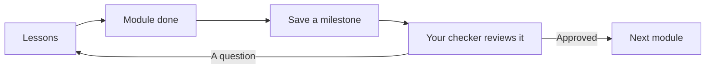

# Welcome to the tour

This little course shows **every kind of lesson** inPace can hold. Each lesson is short, so the whole tour takes about an hour.

## How a course works

- A course has **modules**, and each module has **lessons**.
- The next module opens when you finish the one before.
- Some modules end with **tasks**: upload your work, explain an idea, or take a quiz.
- When you finish a part, save a **milestone** and send it to your **checker**.

## The same thing, as a diagram

Lessons can have diagrams too. Write them as text in a code block marked `mermaid`, and inPace draws them:

## What you'll see in this tour

| Module | Kinds of lessons |
|---|---|
| Start here | Text, pictures, diagrams, tables and code |
| Watch and listen | Video, audio and YouTube |
| Read a book | Parts of a PDF book, each on its own pages |
| Word, PowerPoint and Excel | Office files, shown right in the lesson |
| Try it yourself | A web page you can use, then tasks and a quiz |

> Tip: press **N** for the next lesson and **P** for the one before.
